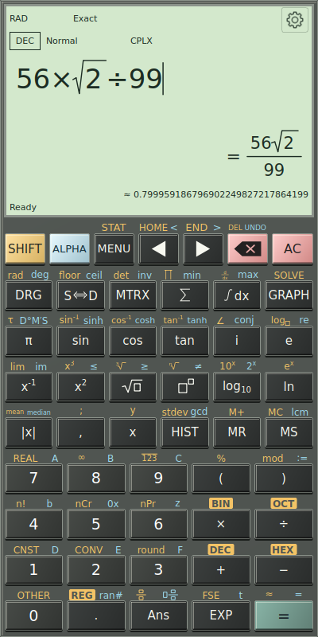
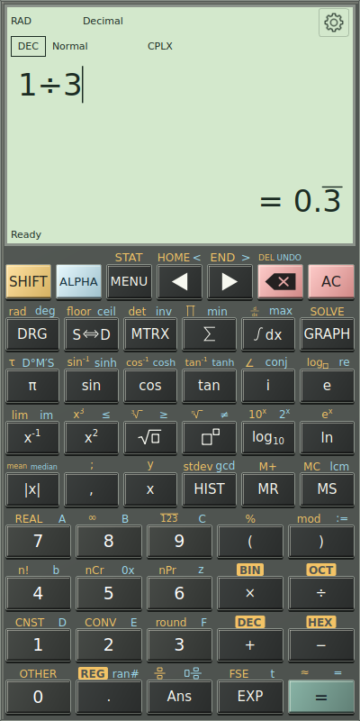

On the calculator, enter **147 + 375**, then tap **=**. The result is **522**. **AC** clears the current input and display; it does not erase History, memory or registers. Backspace removes the item beside the cursor.

Next enter `1/3+1/6` and evaluate. In Exact presentation the result is `1/2`. Tap **S⇔D** to display `0.5`, then tap it again to return to the exact fraction. This changes the presentation of the stored answer without calculating again.

*The display shows the angle convention, number base, notation and number domain above the expression. The gear opens Settings. The upper keypad rows contain editing, scientific and navigation controls; the lower rows contain numbers and arithmetic.*

The display distinguishes three things:

- **Expression:** what you are entering.
- **Confirmed result:** the value produced by an explicit calculation.
- **Preview:** an optional automatic result while typing, when Continuous evaluation is enabled.

**Ans** inserts the last confirmed successful answer. A preview does not replace Ans or add a History entry. When input is incomplete or invalid, do not treat an earlier value as the answer to the new expression.

## Understand `=` and `≈`

`=` means the displayed representation is exact. `≈` means it is approximate or rounded. An overline marks the repeating part of an exact recurring decimal: one third can appear as `0.3` with a bar over the 3. If the full recurring cycle cannot fit the precision budget, the app uses an approximation instead of falsely marking rounded digits exact.

*S⇔D can show a recurring decimal without discarding the exact rational value.*

**S⇔D** reformats a confirmed answer. **SHIFT**, then **=**, evaluates the current expression again in Decimal mode. These are different actions, especially with changing variables or random values.

---

[Previous: Install and open](01-install.md) · [Manual contents](./) · [Next: Touch editing and keypad layers](03-touch-editing.md)
