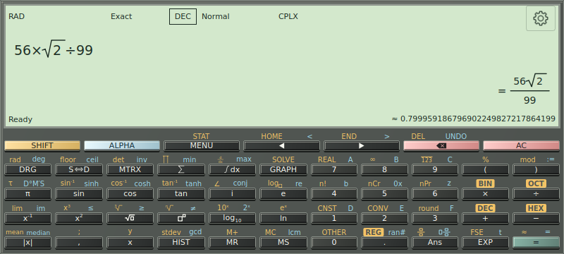

Tap **MENU**. The **Large buttons** layout groups tools into four categories. **Quick access** shows tool shortcuts directly. Change the menu layout in Settings or with the menu's layout switch.

| Category | Tools |
| --- | --- |
| Calculate & explore | Calculate, Details, Algebra / Calculus, Steps, Graph / Table |
| Data & tools | Matrix, Data / Statistics, Finance, Programmer, Toolbox |
| Saved workspace | History, Definitions, Export workspace, Import workspace |
| Personalize | Input modes, Keypad designer, Settings, Guide |

**Back** first dismisses temporary UI such as a help panel, editing overlay, keyboard or modifier layer, then navigates back through pages. From the main calculator it saves and backgrounds the app. Back does not mean AC.

Lists and workbench forms scroll inside their own panels. Rotate the device for a wider keypad, table or graph. The calculator adapts its layout instead of turning the whole calculator into a scrolling page.

*Landscape reorganizes the same controls. It does not change the calculation or the meaning of the selected base and angle convention.*

---

[Previous: Angle, base, precision and complex numbers](04-calculation-modes.md) · [Manual contents](./) · [Next: History, memory and registers](06-history-memory.md)
