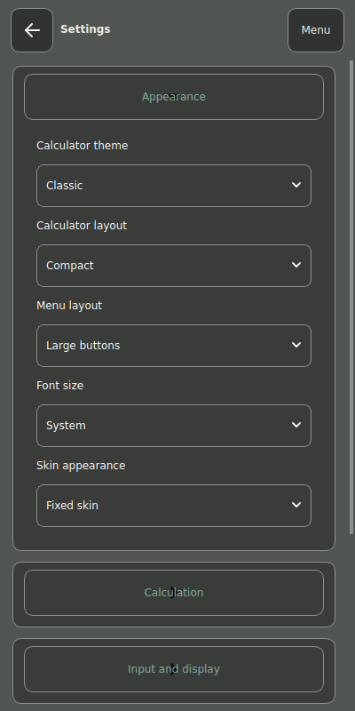
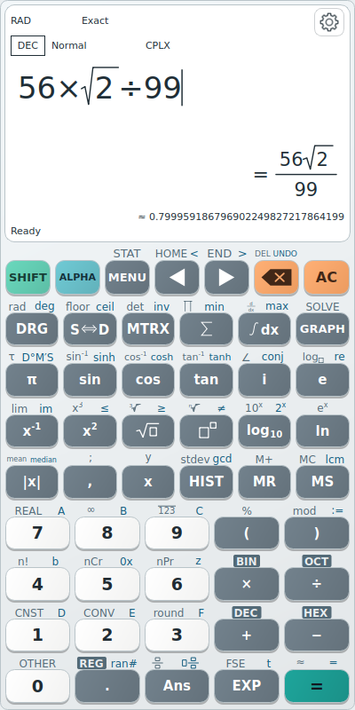

Open the gear, or **MENU → Personalize → Settings**. Settings groups include **Appearance**, **Calculation**, **Input and display**, **Touch and feedback**, **Language**, and **Storage and about**. Changes are saved automatically.

*Appearance contains Calculator theme, Calculator layout, Menu layout, Font size and Skin appearance. Other groups expand within the Settings panel.*

Choose from **Classic**, **Shades of Grey**, **Modern Light**, **Modern Dark**, **Brushed Metal**, **Deep Ocean**, **AMOLED** and **Amber Terminal**. **Skin appearance** can use a **Fixed skin** or **Follow system**. **Font size** offers **Small**, **Medium**, **Large** and **System**.

*Theme changes affect the calculator and supporting pages without changing stored mathematics.*

**Pocket**, **Compact** and **Expanded** provide 39, 51 and 57 keys respectively. A smaller layout moves some functions onto alternate layers; choose Compact while following the key examples in this manual.

Other controls include exact improper/mixed fractions, continuous evaluation, number domain, precision, decimal separator, digit grouping, percentage and implicit-multiplication behaviour. Continuous evaluation starts Off. If you use a comma decimal separator, the display adjusts argument separators and avoids using comma grouping ambiguously; portable copied mathematical syntax uses canonical separators.

The nine interface languages are English, Hungarian, German, French, Spanish, Italian, Russian, Simplified Chinese and Japanese. Mathematical identifiers remain portable; engine-provided catalog text may differ from translated interface labels.

Sound and vibration have separate switches. Key sound uses Android's media volume; vibration follows Android's haptic settings. Key help and screen help can be disabled independently. An external keyboard can use Enter to evaluate, F2/F3 for SHIFT/ALPHA, F4 for angle, F5 for S⇔D and standard editing shortcuts.

---

[Previous: Other ways to calculate](11-input-workflows.md) · [Manual contents](./) · [Next: Save, export and restore work](13-save-restore.md)
